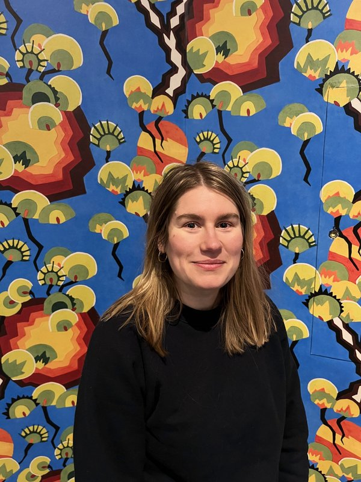


I am an Assistant Professor of Philosophy and French and a core faculty member in Women’s and Gender Studies at the University of New Hampshire.

My research is in moral philosophy and in feminist, social and political philosophy. I’m particularly interested in the moral psychology of oppression, bioethics, and the history of Francophone philosophy in the 20th century. I received my PhD from the École normale supérieure in Paris in 2018. From 2018 to 2019, I was a postdoctoral fellow at the Jeanne Garnier palliative care unit in Paris. From 2019 to 2021, I was an Assistant Professor of Philosophy at the University of Strasbourg.

[Here is my CV.](/files/LAURE_BARILLAS_CV_November_2026.pdf)

You can write to me at [laure.barillas@unh.edu](mailto:laure.barillas@unh.edu).


{{ bio | markdownify }}

